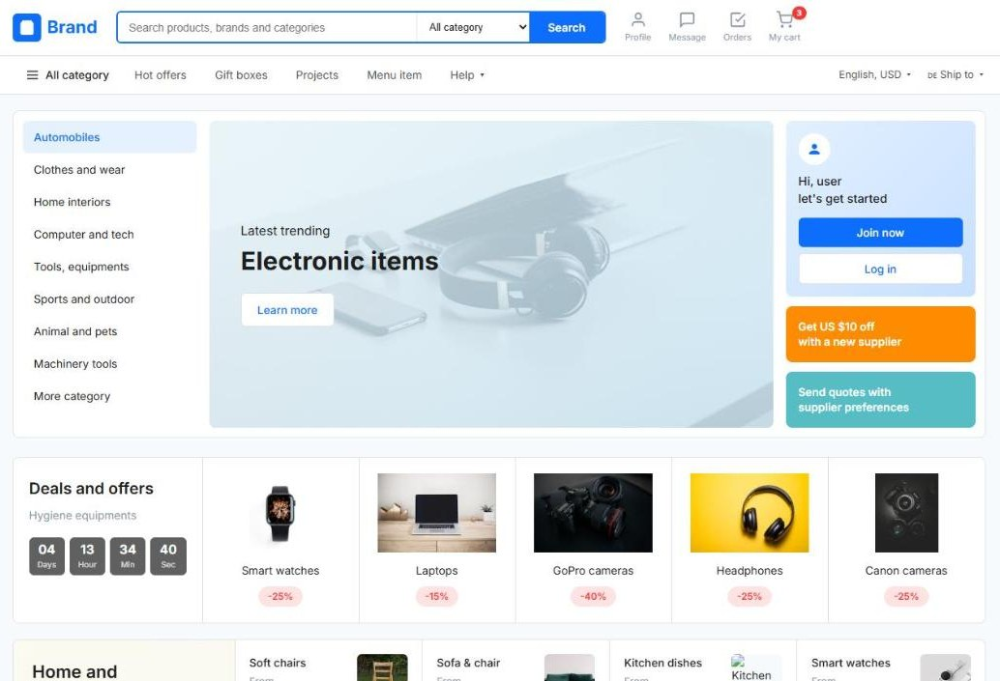

<div align="center">

# E-commerce Marketplace Frontend

**A three-page B2B marketplace UI built from a Figma design with plain HTML, CSS and JavaScript.**

[](https://connectabdullahdev.github.io/ecommerce-frontend-design/)




</div>

## About

Project 1 of my front-end internship at **DevelopersHub Corporation**, built over three weeks from the [Ecommerce Web Design (Community)](https://www.figma.com/design/8Igr4IzlG1bE1ko7gOyNQP/Ecommerce-Web-Design-(Community)) Figma file.

## Pages

| Page | Highlights |
| --- | --- |
| [Home](https://connectabdullahdev.github.io/ecommerce-frontend-design/) | Category sidebar, hero banner, deals with a live countdown, home and electronics sections, inquiry form, recommended items, suppliers by region, newsletter |
| [Product list](https://connectabdullahdev.github.io/ecommerce-frontend-design/product-list.html) | Filters for category, brand, features, price, condition and rating; removable filter tags; grid and list views; pagination |
| [Product detail](https://connectabdullahdev.github.io/ecommerce-frontend-design/product-detail.html) | Image gallery with thumbnails, price tiers, size and colour options, supplier card, tabs for description, reviews, shipping and seller, related products |

## Interactivity

Written in vanilla JavaScript (`js/script.js`): search, category selection, filter tags, grid/list toggle, pagination, tabs, image gallery, size dropdown, add-to-cart animation, wishlist toggle, deals countdown timer, price tiers, inquiry form and newsletter signup.

## Tech stack

- **HTML5** with semantic structure
- **CSS3** with Flexbox, Grid and animations, in one shared stylesheet
- **Vanilla JavaScript** for all interactivity
- Inter (Google Fonts), Unsplash images, FlagCDN flags

The layout is desktop-first, as the task required, with responsive adjustments for tablets.

## Run it locally

```bash
git clone https://github.com/connectabdullahdev/ecommerce-frontend-design.git
cd ecommerce-frontend-design
python -m http.server 8000   # then open http://localhost:8000
```

## Project structure

```
ecommerce-frontend-design/
├── index.html            # home page
├── product-list.html     # listing with filters
├── product-detail.html   # product detail
├── css/style.css         # shared styles
├── js/script.js          # interactivity
└── docs/                 # screenshots
```

---

<div align="center">

Built by **Muhammad Abdullah** during the DevelopersHub Corporation front-end internship · [LinkedIn](https://www.linkedin.com/in/connectabdullahdev) · [GitHub](https://github.com/connectabdullahdev)

</div>
